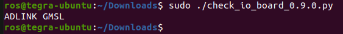
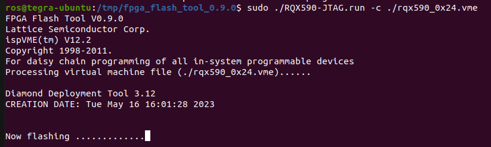
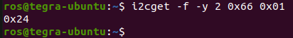
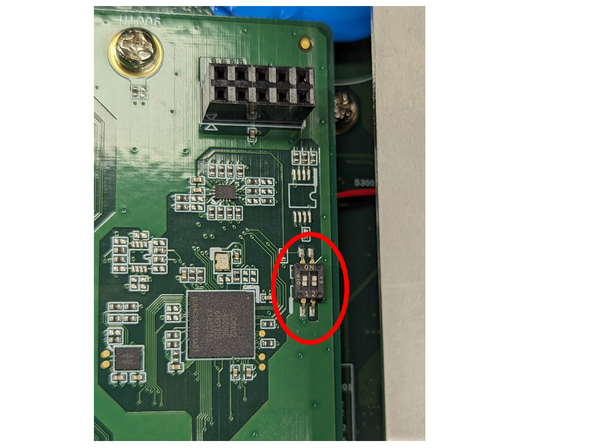

# rqx-release-sw
Public released software for ROScube-X series.

Please go to the [release page](https://github.com/Adlink-ROS/rqx-release-sw/releases) to download.

The latest FPGA flash tool:

- fpga_flash_tool_0.9.5

The latest FPGA firmware:

- rqx590_0x24.vme
- rqx31g_rqx71g_0x1160.vme

## FPGA Flash Tool

Currently, this tool supports the following platforms:

- **RQX-59G** with `ADLINK GMSL` board 
- **RQX-59F** with `ADLINK FPDL` board
- **RQX-31G**
- **RQX-71G**

For RQX-59x, please download `rqx59x_check_io_board.py` from the release page to identify the installed I/O board.

```bash
chmod +x rqx59x_check_io_board.py
sudo ./rqx59x_check_io_board.py
```



## RQX series FPGA Firmware

### How to get version
```bash
i2cget -f -y 2 0x66 0x01
```

### How to flash

Please follow the instructions below to flash RQX FPGA:

1. Download and extract `fpga_flash_tool_<ver>.tgz`

    ```bash
    tar zxvf fpga_flash_tool_0.9.5.tgz
    ```

2. Run the following commands to flash the FPGA:

    ```bash
    cd fpga_flash_tool_0.9.5
    chmod +x fpga_flash_tool.run
    sudo ./fpga_flash_tool.run rqx590 -c rqx590_0x24.vme
    ```

    

3. Verify the firmware version by reading register 0x01. If the flash was successful, the command returns the updated version:

    ```bash
    i2cget -f -y 2 0x66 0x01
    i2cget -f -y 2 0x66 0x02 # for rqx31g and rqx71g
    ```
    

### Troubleshooting

For RQX-59x series, if flashing fails, ensure that the DIP switches on the I/O board are set to ON
    

